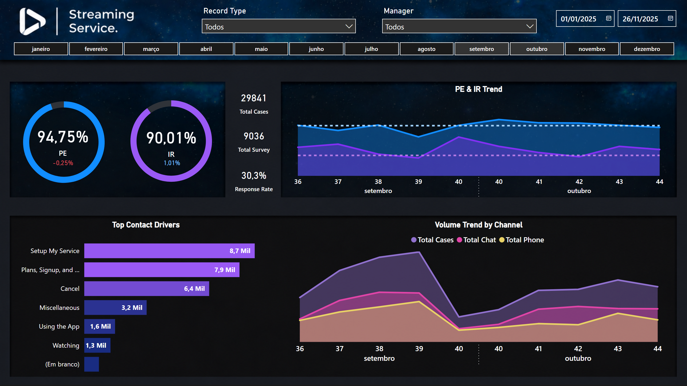
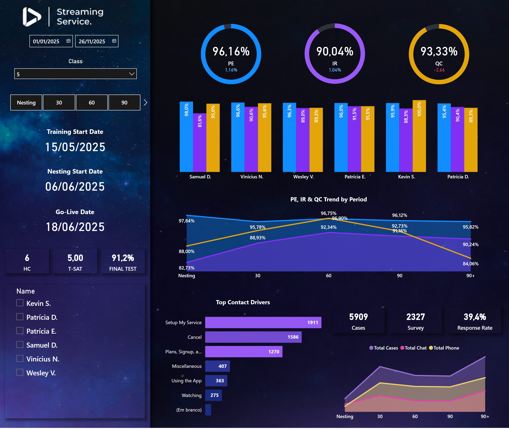
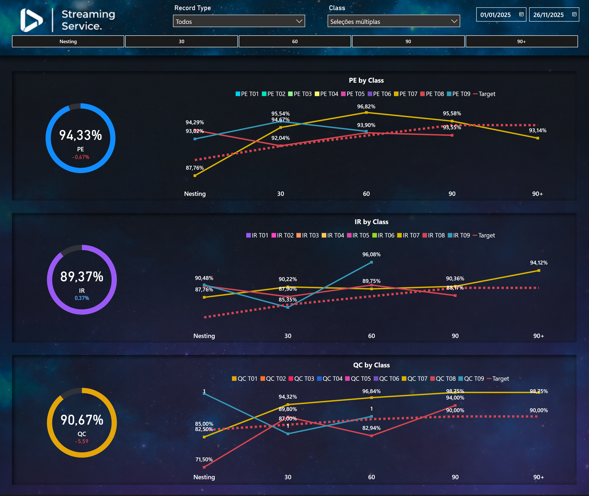

# Training Performance Analytics Hub (Power BI)

Do treinamento à operação: como cada turma de New Hires evolui em **Positive Experience (PE)**, **Issue Resolution (IR)** e **qualidade (QC)**, do nesting aos 90 dias.

**[▶ Abrir o dashboard interativo](https://app.powerbi.com/view?r=eyJrIjoiNDM5ZThiYWMtYTVlYS00ZWM5LWEzY2EtMTgyYmY3N2FkM2YzIiwidCI6ImJmYTcyOWViLWFhYTQtNDAyYS1iYzY0LWE1MzlkNGI5NTY1NyJ9)**



> Meu primeiro dashboard, construído do zero enquanto eu estudava Power BI e DAX, e usado na rotina de Treinamento & Desenvolvimento nas apresentações de resultado com a gerência. Esta é a **versão de portfólio**: base fictícia que preserva o formato das curvas da operação, com nomes, números e comentários trocados.

## O problema

Como líder educador, eu precisava responder toda semana se as turmas de New Hires e as ações de reciclagem estavam funcionando. Os dados vinham de exportações do Salesforce e do Tableau para Excel: pesquisa, qualidade e datas de cada turma em arquivos separados, cruzados à mão. O dashboard coloca cada novato na mesma régua da operação, fase por fase.

## As páginas

| Página | Pergunta |
|---|---|
| Visão Operacional | Como a operação está entregando? |
| Ramp-up New Hire | Como cada novato evolui do nesting aos 90 dias? |
| Comparativo de Turmas | Qual turma chegou mais rápido na meta? |

<p>
  
  
</p>

## A peça central: o período de ramp-up

Cada atendimento é posicionado na jornada do agente que atendeu, a partir das datas de nesting e go-live. É isso que permite comparar turmas diferentes no mesmo eixo, com **metas escalonadas por fase** (novato não é cobrado pela meta cheia no primeiro dia).

```dax
PeriodoNH =
VAR Agente = 'Base cases'[Case Owner Email]
VAR DataAtendimento = 'Base cases'[Date]
VAR DataInicioNesting = CALCULATE ( MAX ( 'BASE NH'[Inicio Nesting] ), FILTER ( 'BASE NH', 'BASE NH'[User Email] = Agente ) )
VAR DataGoLive = CALCULATE ( MAX ( 'BASE NH'[GO LIVE] ), FILTER ( 'BASE NH', 'BASE NH'[User Email] = Agente ) )
VAR DiasPosGoLive = DATEDIFF ( DataGoLive, DataAtendimento, DAY )
RETURN
    IF ( ISBLANK ( DataGoLive ), BLANK (),
        SWITCH ( TRUE (),
            DataAtendimento >= DataInicioNesting && DataAtendimento < DataGoLive, "Nesting",
            DiasPosGoLive <= 30, "30",
            DiasPosGoLive <= 60, "60",
            DiasPosGoLive <= 90, "90",
            "90+" ) )
```

## O que eu faria diferente hoje

Este é o meu primeiro projeto, e mantive o modelo como foi feito. Na v2 eu faria:
- uma medida por indicador com a turma na legenda, no lugar de uma medida por turma (27 hoje);
- uma tabela calendário própria no lugar das datas automáticas do Power BI;
- as metas numa tabela, em vez de fixas no código.

## Como abrir

1. Clone o repositório ou baixe o ZIP.
2. Abra `pbip/Training Hub.pbip` no Power BI Desktop.
3. Em **Transformar dados → Editar parâmetros**, aponte `Caminho_Base` para a pasta `dados/`.
4. Clique em **Atualizar**.

## Ferramentas

Power BI · DAX · Power Query

---

Felipe Principe · [LinkedIn](https://www.linkedin.com/in/felipe-principe-731b7116a/) · [GitHub](https://github.com/felipe-principe)
